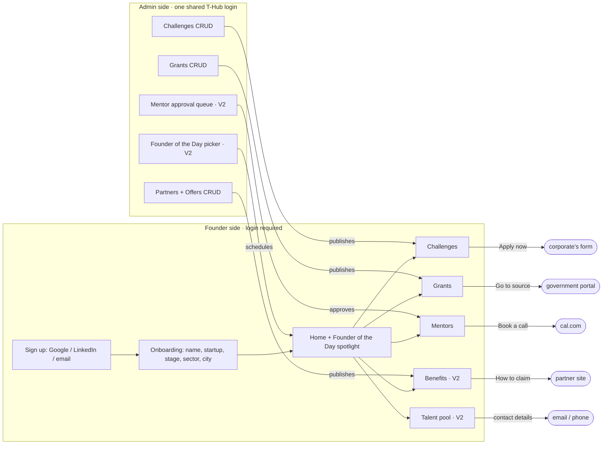
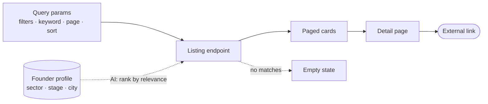
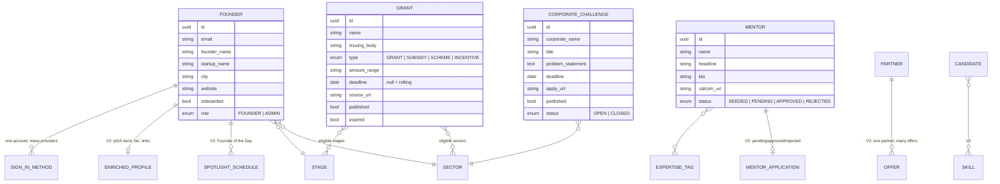
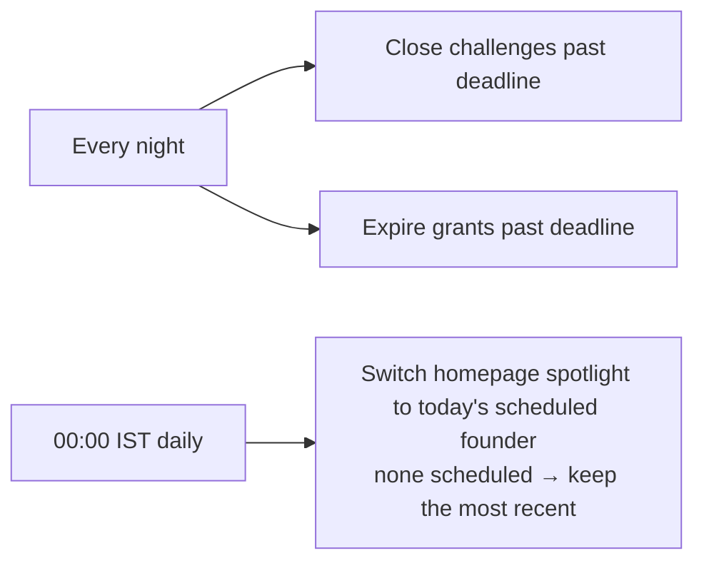

# What is Outpost?

**One sentence:** Outpost is a members-only directory website for startup founders at T-Hub, where T-Hub staff curate the listings and founders browse them.

It is a curated Yellow Pages with a login. Nothing transactional happens *inside* it — every "do something" button links out (cal.com, the corporate's form, the government portal, the partner's site). Booking, applications, messaging, payments, scoring: all explicitly parked.

Read this first, then the spec (`Outpost-Prod-Spec.pdf`). The spec is module-by-module and half of it is "what we won't build"; this page is the shape.

---

## 1. Two sides of one site

Admin **writes**, founders **read**, every action **leaves the site**.

---

## 2. Every listing is the same page

Five of the six founder modules are one pattern repeated. Learn it once on Grants (Week 1), then reuse it.

| Module | Filters | Keyword over | Detail page | External action | Hidden by default |
|---|---|---|---|---|---|
| Mentors | expertise (multi), stage, sector | name, headline, expertise | yes | cal.com link | — |
| Challenges | sector, theme, corporate, status | title, problem statement | optional (some have none) | Apply URL | closed stay visible, marked |
| Grants | issuing body, type, stage, sector, amount band, deadline bucket | name, issuing body, summary | yes | source URL | expired |
| Benefits (V2) | category, partner | partner name, headline | yes | claim link/code | expired |
| Talent pool (V2) | role, skills, experience, location, availability | name, role, skills | resume page | contact details | signed-in only |

"Integrated AI" = each listing has a *recommend for me* mode that ranks results using the founder's profile. A smarter search, not a chatbot.

---

## 3. Data model — the member spine

The founder's profile is the one table everything hangs off. Nothing else references anything else.

Note what is *absent*: no bookings, no applications, no messages, no claims. Those tables would exist in a transactional product; here the transaction happens elsewhere. The spec says the spine must let future modules attach records "without migrating the spine" — that is why `ENRICHED_PROFILE` is its own table, not columns on `FOUNDER`.

---

## 4. The only things that happen on a clock

Three scheduled jobs. That is the entire "backend logic" beyond CRUD, filtering and auth.

---

## 5. V1 vs V2

Nothing exists yet. V1 and V2 are two releases of the same product inside this engagement.

| | V1 · Phase 1 | V2 · Phase 2 |
|---|---|---|
| Profile | basic fields | + pitch deck, bio, links |
| Mentors | seeded list, cal.com | + apply form, admin approval |
| Challenges | complete | — |
| Grants | complete | — |
| Admin | grants, challenges, partners, offers | + mentor queue, Founder of the Day |
| Benefits | — | new |
| Talent pool | — | new |
| Founder of the Day | — | new |

V1 = the site works. V2 = the site has more lists and the profile grows.

---

## 6. What the backend actually is

Strip the prose and you have:

- **Auth:** 3 sign-in methods → 1 account; email verification; password reset; forced onboarding; FOUNDER vs ADMIN
- **Six listing endpoints** with filters, keyword search, pagination, sort, AI ranking
- **Admin CRUD** with publish/unpublish for 5 content types
- **One approval workflow** (mentor applications)
- **One file upload** (pitch deck) to object storage
- **Three scheduled jobs**
- **One external API integration** (the LLM)

Broad, not deep. That is why it fits in four weeks — and why every one of those bullets is an interview topic.
